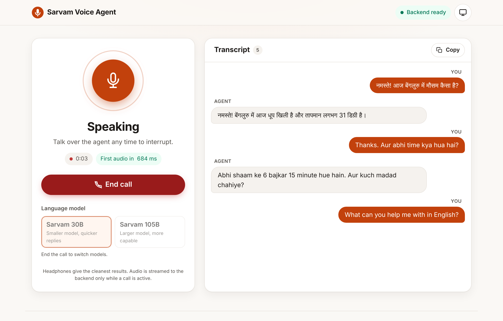
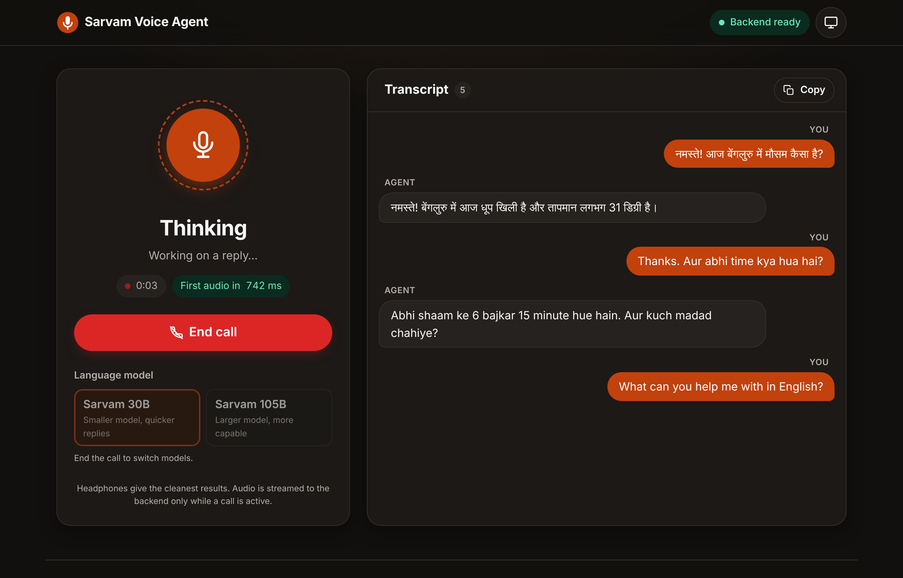
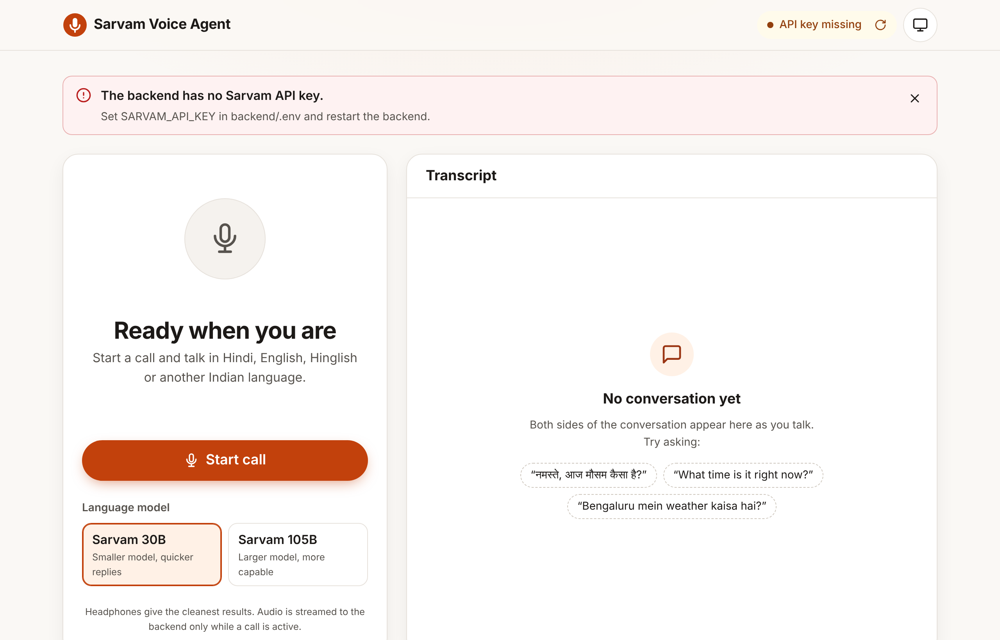
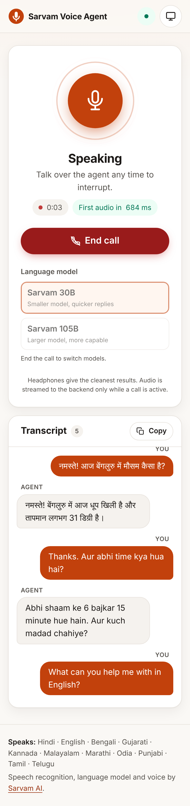
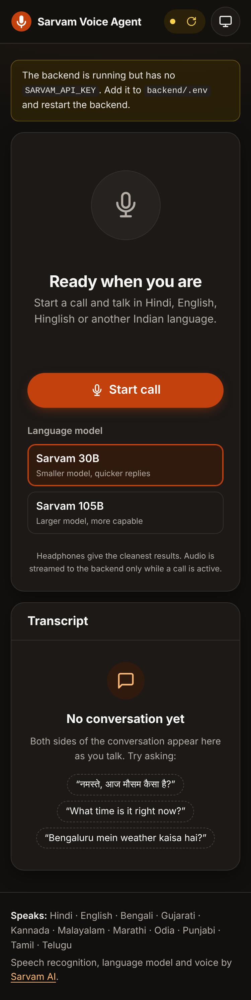
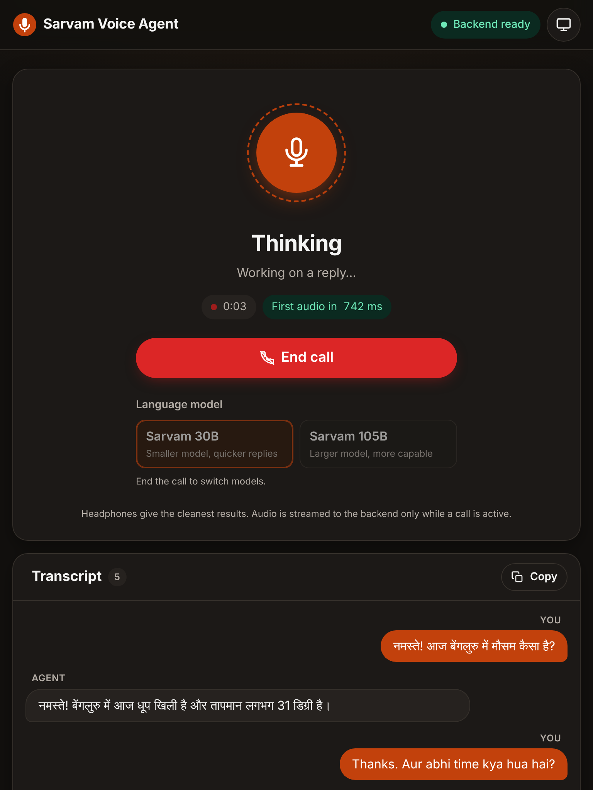
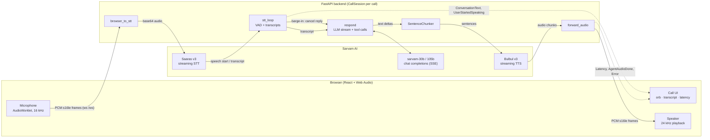
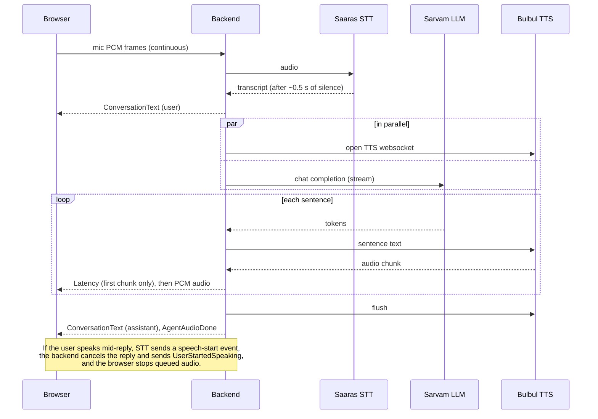

# Sarvam Voice Agent

**Talk to an AI on a live voice call in Hindi, English, Hinglish or other Indian languages. Speech recognition, the language model and the voice are all streamed from Sarvam AI.**




---

## Table of contents

- [Overview](#overview)
- [Screenshots](#screenshots)
- [Features](#features)
- [Tech stack](#tech-stack)
- [Architecture](#architecture)
- [Project structure](#project-structure)
- [Prerequisites](#prerequisites)
- [Installation](#installation)
- [Configuration](#configuration)
- [Running the app](#running-the-app)
- [Usage](#usage)
- [API reference](#api-reference)
- [Scripts and commands](#scripts-and-commands)
- [Testing](#testing)
- [Linting and formatting](#linting-and-formatting)
- [Deployment](#deployment)
- [Extending the agent](#extending-the-agent)
- [Troubleshooting and FAQ](#troubleshooting-and-faq)
- [Known limitations](#known-limitations)
- [Roadmap ideas](#roadmap-ideas)
- [Contributing](#contributing)
- [License](#license)

---

## Overview

Most voice assistants are built for English first. Indian users switch between Hindi, English and their regional language in a single sentence, and they expect a reply that feels like a phone call, not a turn-based chatbot.

Sarvam Voice Agent is a small, readable reference implementation of a **real-time, full-duplex voice agent for Indian languages**:

1. The browser streams your microphone to a FastAPI backend over a websocket.
2. The backend streams that audio to **Sarvam Saaras v3** speech-to-text. Server-side voice activity detection decides when you've finished speaking.
3. The transcript goes to a **Sarvam LLM** (`sarvam-30b` or `sarvam-105b`). Tokens stream back and are cut into sentences.
4. Each sentence is sent straight to **Sarvam Bulbul v3** text-to-speech, in the language you spoke. The audio streams back to the browser and starts playing before the reply has finished generating.

If you start talking while the agent is speaking, it stops and listens. That is barge-in.

**Who it's for**

- Developers who want a working starting point for a voice bot on Sarvam's APIs (support lines, booking assistants, kiosks, accessibility tools).
- Anyone evaluating Sarvam's STT, LLM and TTS latency together, end to end.
- Learners who want to see streaming STT → LLM → TTS wired together in about 600 lines of Python and a small React app.

---

## Screenshots

All screenshots were captured from the running app with Playwright, using headless Chromium with a fake microphone. No Sarvam API key was available when they were taken. The **in-call** screenshots therefore use a scripted stand-in for the backend websocket that replays a fixed demo conversation; the UI itself is the real, unmodified frontend. The **idle** and **error** screenshots come from the real backend running without `SARVAM_API_KEY`.

| Desktop, dark theme, agent thinking | Error state (backend has no API key) |
| --- | --- |
|  |  |

| Phone, in call | Phone, idle, dark theme, setup notice | Tablet, dark theme |
| --- | --- | --- |
|  |  |  |

---

## Features

**Voice pipeline (backend)**

- **Streaming speech-to-text** with Saaras v3. The language is auto-detected, and high-sensitivity server-side VAD ends a turn after about 0.5 s of silence.
- **Streaming LLM replies** from `sarvam-30b` or `sarvam-105b`. Reasoning is turned off and replies are capped at 200 tokens to keep latency low. The system prompt asks for one or two short spoken sentences in the user's language.
- **Streaming text-to-speech** with Bulbul v3 (voice `shubh` by default). The voice language follows the user: the backend uses the language code reported by the STT when Bulbul supports it, and otherwise detects the dominant script of the transcript (Devanagari, Bengali, Gurmukhi, Gujarati, Odia, Tamil, Telugu, Kannada, Malayalam or Latin).
- **Overlapped stages.** The TTS websocket is opened while the LLM request is still in flight, and LLM output is fed to TTS sentence by sentence. `SentenceChunker` splits on `.`, `?`, `!` and the Devanagari danda `।`. It releases the first sentence immediately, for low latency, and batches later ones into slightly longer chunks.
- **Barge-in.** When the STT reports that you've started speaking, the reply in progress is cancelled, its sockets are closed, and the browser drops any queued audio.
- **Function calling.** OpenAI-style tool calls are executed on the server and their results are fed back to the LLM, for up to 5 rounds. Two demo tools are included: `get_current_time` and `get_weather` (mock data).
- **Bounded memory.** Conversation history is trimmed to the system prompt plus the last 40 messages.
- **Safe defaults.** Allowed browser origins are checked for both CORS and the websocket, only allow-listed model names are accepted, and the server binds to `127.0.0.1` by default.

**Web app (frontend)**

- **Call orb** that animates differently for *connecting*, *listening*, *thinking* and *speaking*, plus a call timer and a **"first audio in N ms"** latency chip.
- **Live chat-style transcript** of both sides, with an empty state, example prompts and **Copy to clipboard**.
- **Backend health indicator** that calls `GET /health` on load. It shows *Backend ready*, *API key missing* or *Backend offline*, with a re-check button and a notice explaining how to fix each problem.
- **Actionable error messages** for: microphone denied, no microphone, microphone busy, unsupported browser, backend unreachable, and errors sent by the backend (for example a missing API key).
- **Model picker** for 30B or 105B. It is locked during a call.
- **Light, dark and system themes.** The saved choice is applied before first paint, so there's no flash.
- **Responsive layout:** two columns on desktop, stacked on tablets and phones. Checked at 375 px, 768 px and 1280 px with no horizontal scroll.
- **Accessibility:** skip link, landmark regions, live status region, labelled controls, keyboard-operable radio-group model picker, visible focus rings, WCAG AA colour contrast, and support for `prefers-reduced-motion`.
- **Mic capture on an AudioWorklet** (off the main thread). It falls back to `ScriptProcessorNode` on browsers without AudioWorklet support.
- **Echo-cancellation friendly playback.** Agent audio is played through an `<audio>` element so the browser's echo canceller can remove it from the mic signal.

---

## Tech stack

| Layer | Technology | Notes |
| --- | --- | --- |
| Speech-to-text | Sarvam **Saaras v3** (`saaras:v3`) | Streaming websocket via the `sarvamai` SDK, VAD signals on |
| Language model | Sarvam **sarvam-30b** / **sarvam-105b** | `POST https://api.sarvam.ai/v1/chat/completions`, SSE streaming |
| Text-to-speech | Sarvam **Bulbul v3** (`bulbul:v3`) | Streaming websocket, 24 kHz PCM output |
| Backend | Python 3.10+, FastAPI, Uvicorn, `httpx`, `websockets`, `python-dotenv` | Single websocket endpoint plus a health check |
| Frontend | React 18, Vite 6, Web Audio API (AudioWorklet) | No UI framework; plain CSS with design tokens |
| Backend tooling | pytest, pytest-asyncio, Ruff | Config in `backend/pyproject.toml` |
| Frontend tooling | Vitest, ESLint 10 (flat config), Prettier | Config in `frontend/` |
| Packaging and CI | Docker (backend), GitHub Actions | `backend/Dockerfile`, `.github/workflows/ci.yml` |

---

## Architecture



### One conversational turn



### Key design decisions

- **One `CallSession` per websocket.** It owns the history, the in-flight reply task and a `generation` counter. Every barge-in bumps the counter, so stale audio from a cancelled reply is never forwarded.
- **TTS language is chosen per turn,** so a user can switch from Hindi to Tamil mid-call and the voice follows.
- **Errors reach the user.** LLM, TTS and STT failures are logged on the server and also sent to the browser as `Error` events, which the UI shows as a banner.

---

## Project structure

```text
.
├── backend/
│   ├── main.py              # FastAPI app: GET /health, WS /ws, CallSession (the per-call pipeline)
│   ├── config.py            # Settings loaded from the environment / .env; allowed LLM models
│   ├── llm.py               # Streaming chat client, SSE parsing, tool-call assembly, tool loop (max 5 rounds)
│   ├── tts.py               # Bulbul v3 websocket helpers and SentenceChunker
│   ├── language.py          # Picks the TTS language from the STT result or the transcript's script
│   ├── agent_functions.py   # Tool definitions (sent to the LLM) and their implementations
│   ├── tests/               # pytest suite (44 tests, all offline: Sarvam services are faked)
│   ├── Dockerfile           # python:3.12-slim, runs as a non-root user
│   ├── .env.example         # Every backend setting, with comments
│   ├── pyproject.toml       # Ruff and pytest configuration
│   ├── requirements.txt     # Runtime dependencies
│   └── requirements-dev.txt # + pytest, pytest-asyncio, ruff
├── frontend/
│   ├── index.html           # Title, meta description, Open Graph tags, theme-before-paint script
│   ├── public/
│   │   ├── favicon.svg
│   │   └── mic-worklet.js   # AudioWorklet that batches mic samples into 4096-sample frames
│   ├── src/
│   │   ├── main.jsx         # React entry point
│   │   ├── App.jsx          # Page layout: header, notices, call panel, transcript, footer
│   │   ├── styles.css       # Design tokens (spacing, type, colour, motion), light/dark themes, components
│   │   ├── components/
│   │   │   ├── Header.jsx       # Brand, backend health pill, theme switcher
│   │   │   ├── CallPanel.jsx    # Orb, status, timer, latency, start/end button, model picker
│   │   │   ├── Transcript.jsx   # Chat transcript, empty state, copy button
│   │   │   ├── ErrorBanner.jsx  # Dismissible alert with a hint
│   │   │   └── icons.jsx        # Inline SVG icons
│   │   ├── hooks/
│   │   │   ├── useVoiceCall.js     # Mic capture, websocket, playback, barge-in, call state
│   │   │   ├── useBackendHealth.js # GET /health with timeout and re-check
│   │   │   └── useTheme.js         # system / light / dark preference
│   │   └── lib/
│   │       ├── audio.js     # PCM conversion helpers and sample rates
│   │       ├── config.js    # Websocket and health URLs, model list
│   │       ├── errors.js    # User-facing error titles and hints
│   │       ├── format.js    # Duration and transcript formatting
│   │       └── *.test.js    # Vitest unit tests
│   ├── .env.example
│   ├── eslint.config.js
│   ├── vite.config.js       # Dev server on port 5177
│   └── package.json
├── docs/screenshots/        # Screenshots used in this README
└── .github/workflows/ci.yml # Lint, format check, tests, build and Docker build
```

---

## Prerequisites

| Requirement | Version | Why |
| --- | --- | --- |
| Python | 3.10 or newer | Backend |
| Node.js and npm | Node 20 or newer | Frontend dev server and build |
| Sarvam API subscription key | — | Get one from the [Sarvam dashboard](https://dashboard.sarvam.ai). Every call uses STT, LLM and TTS credits. |
| A modern browser | Chrome or Edge recommended; recent Safari should work | Needs `getUserMedia`, Web Audio and AudioWorklet. See [the Firefox note](#troubleshooting-and-faq). |
| A microphone | — | Headphones give the best results (less echo) |
| Docker (optional) | Any recent version | Only for the containerised backend |

---

## Installation

### 1. Clone

```bash
git clone https://github.com/jeevithg090/SarvamPipeline.git
cd SarvamPipeline
```

### 2. Backend

```bash
cd backend
python -m venv .venv
source .venv/bin/activate            # Windows: .venv\Scripts\activate
pip install -r requirements.txt      # use requirements-dev.txt to also get pytest and ruff
cp .env.example .env                 # then edit .env and set SARVAM_API_KEY
```

### 3. Frontend

```bash
cd ../frontend
npm install
cp .env.example .env                 # optional: only if the backend isn't on <page host>:8004
```

---

## Configuration

### Backend (`backend/.env`)

All settings are read from environment variables. A `.env` file in `backend/` is loaded automatically (see [`backend/.env.example`](backend/.env.example)).

| Variable | Required | Default | Description |
| --- | --- | --- | --- |
| `SARVAM_API_KEY` | **Yes** | — | Sarvam API subscription key. Without it `/health` reports `"sarvam_key": false` and the websocket refuses calls with an `Error` event. |
| `SARVAM_LANGUAGE` | No | `hi-IN` | TTS language used when the reply language can't be detected. Must be a Bulbul v3 code: `bn-IN`, `en-IN`, `gu-IN`, `hi-IN`, `kn-IN`, `ml-IN`, `mr-IN`, `od-IN`, `pa-IN`, `ta-IN`, `te-IN`. |
| `SARVAM_SPEAKER` | No | `shubh` | Bulbul v3 voice name. |
| `STT_LANGUAGE` | No | `unknown` | STT language code; `unknown` means auto-detect. Set it (for example `hi-IN`) to pin recognition to one language. |
| `LLM_MODEL` | No | `sarvam-30b` | Model used when the client doesn't send `llm_model`. Must be `sarvam-30b` or `sarvam-105b`. |
| `ALLOWED_ORIGINS` | No | `http://localhost:5177,http://127.0.0.1:5177` | Comma-separated browser origins allowed for CORS and the websocket. `*` allows any origin; don't use it on a public server. |
| `HOST` | No | `127.0.0.1` (`0.0.0.0` in Docker) | Bind address for `python main.py` and the Docker image. |
| `PORT` | No | `8004` | Port for `python main.py` and the Docker image. Must be an integer. |

### Frontend (`frontend/.env`, build time)

| Variable | Required | Default | Description |
| --- | --- | --- | --- |
| `VITE_WS_URL` | No | `ws://<page host>:8004/ws` (or `wss://` on HTTPS pages) | Backend websocket URL. The health check URL is derived from it: `wss://api.example.com/ws` becomes `https://api.example.com/health`. |

`VITE_*` variables are inlined when the frontend is built, so change them before running `npm run build` or `npm run dev`.

---

## Running the app

### Development

Use two terminals:

```bash
# Terminal 1: backend on http://127.0.0.1:8004
cd backend && source .venv/bin/activate
python main.py
```

```bash
# Terminal 2: frontend on http://localhost:5177 (hot reload)
cd frontend
npm run dev
```

Open **http://localhost:5177**. The header pill should say **Backend ready**.

> Use `uvicorn main:app --reload --port 8004` instead of `python main.py` if you want the backend to auto-reload when you change code.

### Production-like, locally

```bash
cd frontend
npm run build                         # writes frontend/dist/
npm run preview -- --port 5177        # serves the built app on http://localhost:5177
```

The backend runs the same way as in development (`python main.py`), or with Docker. See [Deployment](#deployment).

---

## Usage

### Walkthrough

1. **Check the header pill.** *Backend ready* means `/health` answered and a key is set. *API key missing* or *Backend offline* comes with a notice explaining the fix; press the refresh icon to check again.
2. **Pick a model.** *Sarvam 30B* (smaller, quicker replies) or *Sarvam 105B* (larger, more capable).
3. **Press "Start call"** and allow microphone access. The orb turns orange and the status changes to **Listening**.
4. **Speak naturally.** For example:
   - "नमस्ते, आज मौसम कैसा है?" (Hindi; uses the demo weather tool)
   - "What time is it right now?" (uses the `get_current_time` tool)
   - "Bengaluru mein weather kaisa hai?" (Hinglish)
5. When you pause, the status goes to **Thinking**, then **Speaking**. The chip shows how long it took from the end of your speech to the first audio, for example `First audio in 742 ms`.
6. **Interrupt any time** by talking over the agent. Its audio stops right away.
7. **Copy** the transcript with the button in the transcript header, and press **End call** when you're done.

### Checking the backend from the command line

```bash
curl http://127.0.0.1:8004/health
```

```json
{ "status": "ok", "sarvam_key": true }
```

### Talking to the websocket without the UI

The protocol is simple enough to script. This Python example opens a call and prints every event it receives. It sends one second of silence, so it won't produce a transcript, but it confirms that the connection and the key, origin and model checks work. Without a key, you'll see the `SARVAM_API_KEY not set` error event followed by close code 1011:

```python
import asyncio, contextlib, json
import websockets  # pip install websockets

async def main():
    url = "ws://127.0.0.1:8004/ws?llm_model=sarvam-30b"
    async with websockets.connect(url) as ws:
        with contextlib.suppress(websockets.ConnectionClosed):
            await ws.send(b"\x00\x00" * 16000)    # 1 s of 16 kHz s16le silence
        try:
            while True:
                msg = await asyncio.wait_for(ws.recv(), timeout=5)
                if isinstance(msg, bytes):
                    print("audio bytes:", len(msg))
                else:
                    print("event:", json.loads(msg))
        except (asyncio.TimeoutError, websockets.ConnectionClosed) as exc:
            print("done:", exc)

asyncio.run(main())
```

Clients that send no `Origin` header (scripts like this one) are allowed. Browsers always send one, and it must be listed in `ALLOWED_ORIGINS`.

---

## API reference

The backend has no user authentication (see [Known limitations](#known-limitations)). Browser access is restricted by origin.

| Method | Path | Auth | Description |
| --- | --- | --- | --- |
| `GET` | `/health` | None (CORS: `ALLOWED_ORIGINS`) | Liveness check. Returns `{"status": "ok", "sarvam_key": <bool>}`. |
| `WS` | `/ws?llm_model=<model>` | `Origin` must be in `ALLOWED_ORIGINS` (if sent) | Full-duplex voice call. `llm_model` is optional (defaults to `LLM_MODEL`) and must be `sarvam-30b` or `sarvam-105b`. |
| `GET` | `/docs`, `/openapi.json` | None | FastAPI's built-in OpenAPI docs (they cover `/health`; websockets aren't described by OpenAPI). |

### Websocket protocol

**Browser → server**

| Frame | Content |
| --- | --- |
| Binary | Microphone audio: 16 kHz, mono, signed 16-bit little-endian PCM. The web app sends 4096-sample frames (about 256 ms). |

**Server → browser**

| Frame | Content |
| --- | --- |
| Binary | Agent audio: 24 kHz, mono, signed 16-bit little-endian PCM |
| JSON `{"type": "ConversationText", "role": "user" \| "assistant", "content": "..."}` | A final user transcript, or the full agent reply once it has been spoken |
| JSON `{"type": "UserStartedSpeaking"}` | Barge-in: the reply in progress was cancelled; drop queued audio |
| JSON `{"type": "Latency", "latency_ms": 742}` | Time from the end of the user's turn to the first agent audio chunk |
| JSON `{"type": "AgentAudioDone"}` | The agent finished its reply |
| JSON `{"type": "Error", "description": "..."}` | Something failed (missing key, unsupported model, LLM/TTS/STT error) |

**Close codes:** `1008` (policy violation) for a disallowed origin or an unsupported model; `1011` (internal error) when `SARVAM_API_KEY` isn't set.

---

## Scripts and commands

### Frontend (`cd frontend`)

| Command | What it does |
| --- | --- |
| `npm run dev` | Vite dev server with hot reload on http://localhost:5177 |
| `npm run build` | Production build to `frontend/dist/` |
| `npm run preview` | Serve the built `dist/` locally (add `-- --port 5177` to match the default allowed origin) |
| `npm run lint` | ESLint (React hooks rules included) |
| `npm run format` | Prettier: rewrite files |
| `npm run format:check` | Prettier: check only (used in CI) |
| `npm test` | Vitest unit tests, run once |

### Backend (`cd backend`)

| Command | What it does |
| --- | --- |
| `python main.py` | Start the server on `HOST:PORT` (default `127.0.0.1:8004`) |
| `uvicorn main:app --reload --port 8004` | Start with auto-reload for development |
| `pytest` / `pytest -q` | Run the test suite |
| `ruff check .` | Lint |
| `ruff format .` / `ruff format --check .` | Format / check formatting |
| `docker build -t sarvam-voice-backend .` | Build the container image |

---

## Testing

```bash
# Backend: 44 tests, no network or API key needed
cd backend
pip install -r requirements-dev.txt
pytest -q

# Frontend: 17 unit tests
cd frontend
npm test
```

**What's covered**

- **Backend** (`backend/tests/`):
  - TTS language selection: script detection for all 10 scripts (Odia maps to `od-IN`), mixed-script text, preferring the STT's language (Marathi vs Hindi), fallbacks
  - `SentenceChunker`: first sentence released immediately, later ones batched, the danda as a boundary, flush
  - SSE parsing, tool-call delta assembly and argument parsing
  - The function-calling loop (tool call, then a streamed answer) and HTTP errors, against a mocked HTTP transport
  - Tool registry and tool error handling
  - `/health`, websocket validation (origin, model allowlist, missing key), and history merging and trimming
  - One full conversational turn through `/ws` with STT, LLM and TTS faked. It checks event order, audio frames, the chosen TTS language and socket clean-up.
- **Frontend** (`frontend/src/lib/*.test.js`):
  - PCM conversion
  - Websocket and health URL building (`ws`/`wss`, env override, path prefixes)
  - Error-message mapping
  - Duration and transcript formatting

**Not covered by automated tests:** real calls against the Sarvam APIs, and React component rendering. The UI was checked manually and with Playwright scripts (see the screenshots section).

---

## Linting and formatting

| Area | Tool | Config | Check | Fix |
| --- | --- | --- | --- | --- |
| Backend | Ruff (lint + format, line length 100, Python 3.10 target) | `backend/pyproject.toml` | `ruff check . && ruff format --check .` | `ruff check --fix . && ruff format .` |
| Frontend | ESLint 10 flat config + React hooks plugin | `frontend/eslint.config.js` | `npm run lint` | — |
| Frontend | Prettier (single quotes, width 100) | `frontend/.prettierrc.json` | `npm run format:check` | `npm run format` |

GitHub Actions ([`.github/workflows/ci.yml`](.github/workflows/ci.yml)) runs all of these, the tests (backend on Python 3.10 and 3.12), the frontend build and a Docker build on pushes to `main` and on pull requests.

---

## Deployment

The app is two parts: a **stateless backend** (any host that runs Python or Docker and supports websockets) and a **static frontend** (any static host or CDN).

### Backend with Docker

```bash
cd backend
docker build -t sarvam-voice-backend .
docker run -d --name sarvam-voice -p 8004:8004 \
  -e SARVAM_API_KEY=sk_... \
  -e ALLOWED_ORIGINS=https://voice.example.com \
  sarvam-voice-backend
curl http://localhost:8004/health
```

The image is based on `python:3.12-slim`, runs as an unprivileged `app` user, and listens on `0.0.0.0:$PORT` (default `8004`).

### Backend without Docker

```bash
cd backend
pip install -r requirements.txt
HOST=0.0.0.0 PORT=8004 python main.py
# or: uvicorn main:app --host 0.0.0.0 --port 8004 --proxy-headers
```

Run it under a process manager (systemd, supervisord, a PaaS) so it restarts on failure.

### Frontend

```bash
cd frontend
VITE_WS_URL=wss://api.example.com/ws npm run build
# upload frontend/dist/ to any static host (Nginx, S3 + CloudFront, Netlify, Vercel, GitHub Pages, ...)
```

The app has a single page and no client-side routes, so no SPA rewrite rules are needed.

### TLS and reverse proxy

Browsers only allow microphone access on **secure origins** (HTTPS or `localhost`), and an HTTPS page can only open `wss://` websockets. Put both behind TLS. An example Nginx location for the backend:

```nginx
location /ws {
    proxy_pass http://127.0.0.1:8004;
    proxy_http_version 1.1;
    proxy_set_header Upgrade $http_upgrade;
    proxy_set_header Connection "upgrade";
    proxy_set_header Host $host;
    proxy_read_timeout 3600s;   # calls are long-lived
}
location /health {
    proxy_pass http://127.0.0.1:8004;
}
```

### Production checklist

- [ ] `SARVAM_API_KEY` is set from a secret store, not committed.
- [ ] `ALLOWED_ORIGINS` lists only your frontend origin(s). Anyone on an allowed origin can spend your Sarvam credits.
- [ ] The frontend was built with the correct `VITE_WS_URL` (`wss://...`).
- [ ] Both parts are served over HTTPS / WSS.
- [ ] The proxy's websocket idle timeout is longer than your expected call length.
- [ ] You've added authentication or rate limiting if the site is public (the backend has none).

---

## Extending the agent

### Add a tool

Tools live in [`backend/agent_functions.py`](backend/agent_functions.py):

```python
async def get_train_status(arguments: dict[str, Any]) -> dict[str, Any]:
    train = str(arguments.get("train_number") or "")
    return {"train_number": train, "status": "on time"}   # call your real API here

FUNCTION_DEFINITIONS.append({
    "name": "get_train_status",
    "description": "Get the running status of an Indian Railways train.",
    "parameters": {
        "type": "object",
        "properties": {"train_number": {"type": "string"}},
        "required": ["train_number"],
    },
})
FUNCTION_MAP["get_train_status"] = get_train_status
```

The function receives the parsed JSON arguments and must return something JSON-serialisable.

### Change the personality

Edit `SYSTEM_PROMPT` in [`backend/main.py`](backend/main.py). Keep replies short and free of markdown, because they're spoken aloud.

### Change the voice or default language

Set `SARVAM_SPEAKER` and `SARVAM_LANGUAGE` in `backend/.env`.

### Add a model

Add it to `ALLOWED_LLM_MODELS` in `backend/config.py`, and to `LLM_MODELS` and `MODEL_INFO` in `frontend/src/lib/config.js`.

---

## Troubleshooting and FAQ

**The header says "Backend offline".**
The page couldn't reach `GET /health`. Check that the backend is running (`curl http://127.0.0.1:8004/health`). If the frontend isn't on `localhost:5177`, add its origin to `ALLOWED_ORIGINS` and restart the backend. If the backend is on another host or port, set `VITE_WS_URL` and rebuild or restart the frontend.

**The header says "API key missing", or a call fails with "The backend has no Sarvam API key".**
Set `SARVAM_API_KEY` in `backend/.env` (not `.env.example`) and restart the backend.

**"Could not reach the voice agent backend."**
Same causes as *Backend offline*. A wrong origin is the most common: the backend closes the websocket with code `1008` if the page's origin isn't allowed.

**"Microphone access was denied."**
Click the lock or camera icon in the address bar, allow the microphone for this site, and start the call again. On macOS, also check *System Settings → Privacy & Security → Microphone* for your browser.

**The microphone works on `localhost` but not when I open the app from my phone via `http://192.168.x.x`.**
Browsers block the microphone on insecure origins other than `localhost`. Serve the frontend over HTTPS (for example with a tunnel or a reverse proxy with a certificate), and use `wss://` for the backend.

**Firefox fails to start audio.**
The app captures at 16 kHz with a dedicated `AudioContext`, and Firefox refuses to connect a microphone stream to a context whose sample rate differs from the device's. Use Chrome, Edge or Safari for now (see [Roadmap ideas](#roadmap-ideas)).

**The agent hears itself and keeps interrupting.**
Use headphones. Echo cancellation is enabled, but laptop speakers at high volume can still leak into the mic and trigger barge-in.

**The agent answers in the wrong language or voice.**
The TTS language comes from the STT's language detection, falling back to the script of the transcript. Hindi and Marathi share Devanagari, so if the STT doesn't report a language, Marathi text may be voiced as Hindi. Setting `STT_LANGUAGE` to a fixed code helps when all users speak one language.

**I see `Unsupported LLM model` in the UI.**
Only `sarvam-30b` and `sarvam-105b` are accepted. See [Add a model](#add-a-model).

**Does it work without an API key for development?**
The UI, the health check and the error paths do, and the whole test suite runs offline. Real speech recognition and replies need a key.

**Is my audio stored?**
Not by this app. Audio is streamed to Sarvam's APIs only while a call is active, and nothing is written to disk. Conversation history lives in memory for the duration of the call. See Sarvam's own terms for how they handle API data.

---

## Known limitations

- **No authentication or rate limiting** on the backend. Restricting origins stops other websites from using it from a browser, but not scripts. Add auth before exposing it publicly.
- **The weather tool returns mock data** (`sunny, 31 °C`). `get_current_time` uses the server's local time zone.
- **Firefox** isn't supported for capture (fixed 16 kHz `AudioContext`; see FAQ).
- **One conversation per websocket.** Nothing is persisted after the call ends.
- **No end-to-end tests against the real Sarvam APIs** in the repository; they're exercised through fakes and mocks only.
- **No React component tests.** UI behaviour is verified manually and with Playwright scripts that aren't part of the repo.

## Roadmap ideas

- Resample in the AudioWorklet so capture works at the device's native rate (fixes Firefox).
- Optional API-key or token authentication and per-client rate limits.
- Show partial (interim) transcripts while the user is still speaking.
- A voice and language picker in the UI.
- Real tool integrations (weather, calendar, search) and a pluggable tool registry.
- Component tests with Testing Library and an end-to-end smoke test with Playwright.
- Metrics (per-stage latency, error counts) exported for dashboards.

---

## Contributing

Contributions are welcome. To keep things smooth:

1. Fork the repository and create a branch from `main`.
2. Set up both parts as described in [Installation](#installation), using `requirements-dev.txt` for the backend.
3. Make your change. Keep functions small and typed, and add or update tests for behaviour changes.
4. Run everything CI runs before opening a pull request:
   ```bash
   (cd backend && ruff check . && ruff format --check . && pytest -q)
   (cd frontend && npm run lint && npm run format:check && npm test && npm run build)
   ```
5. Use [Conventional Commits](https://www.conventionalcommits.org/) (`feat:`, `fix:`, `docs:`, ...) and describe what you changed and how you tested it in the pull request.

Never commit real API keys; `.env` files are git-ignored.

---

## License

This repository does not include a license file yet, so by default all rights are reserved by the author. If you want others to use, modify and share the code, consider adding a permissive license such as **MIT** or **Apache-2.0** (Apache-2.0 also includes an explicit patent grant).

Sarvam, Saaras and Bulbul are products of Sarvam AI. Use of their APIs is subject to Sarvam AI's terms.
